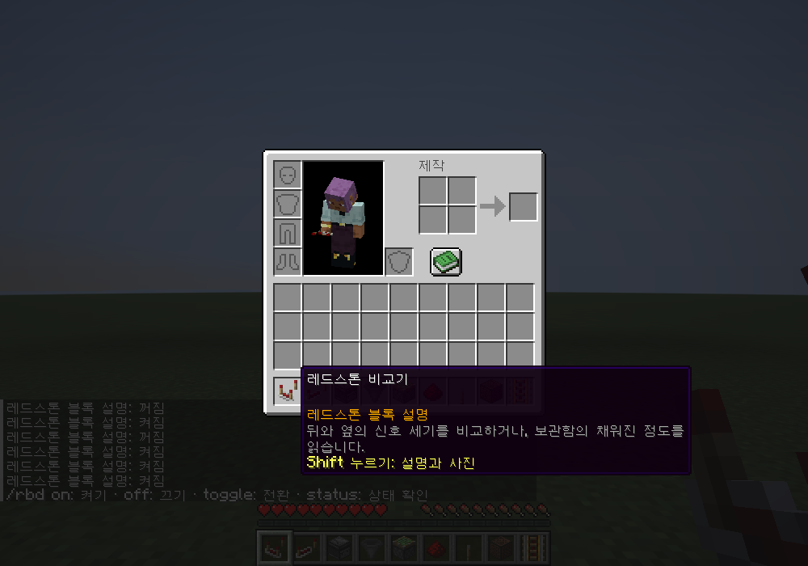
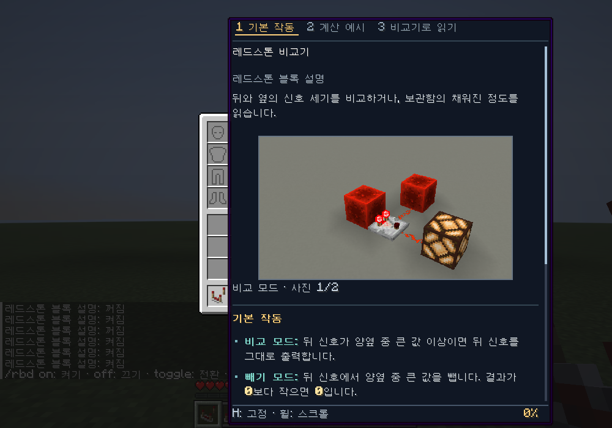
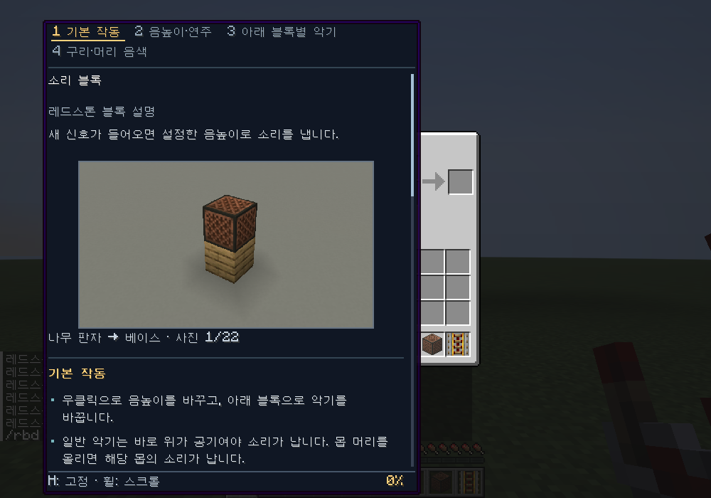
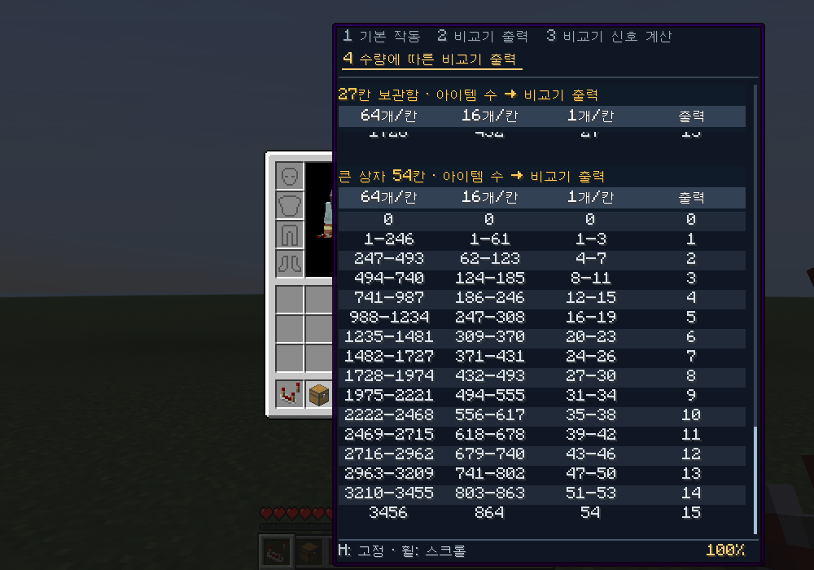
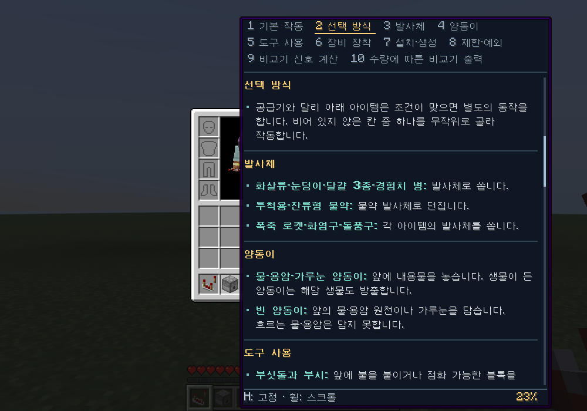
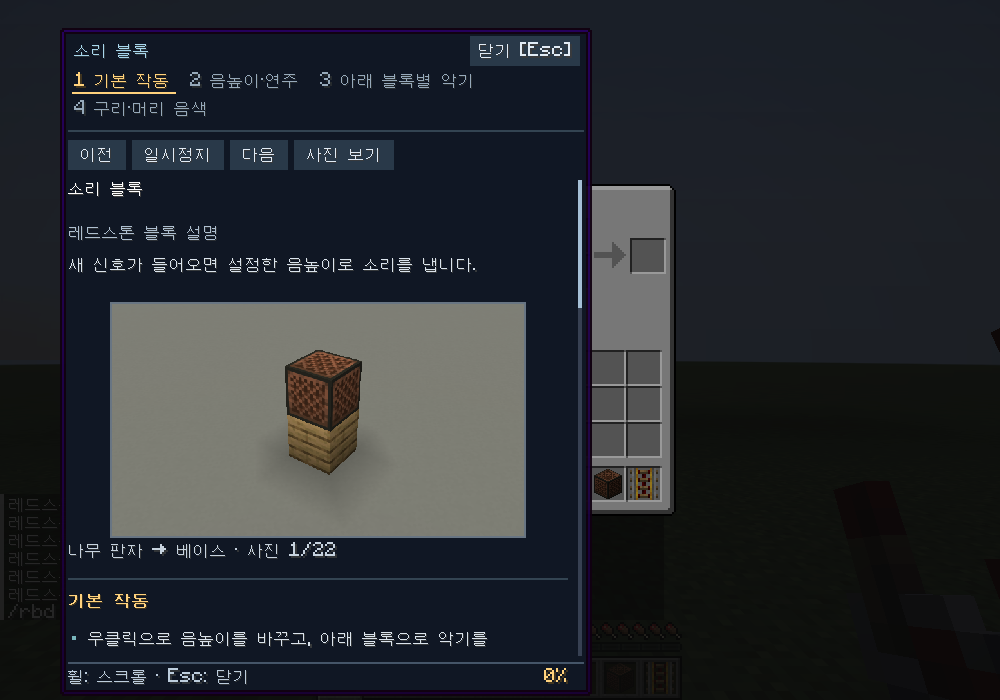
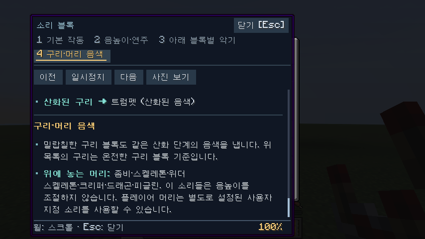

# Redstone Block Description

Minecraft Java **26.2 / Fabric**용 클라이언트 모드입니다.
인벤토리에서 레드스톤 관련 아이템 아이콘에 마우스를 올리면 **블록의 기능과 작동 조건**을 표시합니다.
소스 저장소: [RUOK0214/Redstone_Block_Description](https://github.com/RUOK0214/Redstone_Block_Description).
설치 파일: [GitHub Releases](https://github.com/RUOK0214/Redstone_Block_Description/releases/latest).

## 설치

1. Minecraft Java **26.2**, Fabric Loader **0.19.5 이상**, Java **25 이상** 환경을 준비합니다.
2. `redstone-block-description-0.9.0.jar`와 **Fabric API 0.160.0+26.2**를 해당 게임 프로필의 `mods` 폴더에 넣습니다. 이전 버전의 `redstone-block-description-*.jar` 또는 `redstone-help-*.jar`는 새 파일로 교체합니다.
3. 게임을 실행합니다. Minecraft 언어가 한국어이면 한국어 설명이 표시됩니다.

서버에는 설치할 필요가 없습니다. 다른 프로젝트의 모드나 Mod Menu도 필요하지 않습니다.
`-sources.jar`는 개발용 소스이므로 게임에 설치하지 마세요.

## 사용

- **마우스 올리기:** 아이템 이름과 기존 설명 아래에 핵심 역할을 표시합니다.
- **Shift 누르고 있기:** 신호 세기, 동작 조건, 지연 시간과 **직접 촬영한 인게임 사진**을 표시합니다.
- **Shift를 누른 채 마우스 휠:** 긴 설명을 위아래로 스크롤합니다. 마우스는 아이템 아이콘 위에 둡니다.
- 추가 정보가 있는 아이템은 기존 설명과 약간의 여백을 둔 뒤 **세부 정보**와 수량표를 표시합니다. 사진도 같은 설명 안에 유지하며, Tab 전환은 필요하지 않습니다.
- **고정 키(기본 H):** Shift 상세 설명이 보일 때 지정한 키를 누르면 도움말 창을 고정합니다. 이후에는 Shift를 놓고 마우스를 움직여도 유지됩니다.
- **단축키 변경:** 설정 → 조작 → 키 설정 → **Redstone Block Description → 도움말 창 고정**에서 키보드·마우스 버튼을 지정합니다. 변경한 키는 안내 문구에도 반영되고 게임 설정에 저장됩니다. 미지정 상태에서는 고정 기능을 사용하지 않습니다.
- **목차 클릭:** 고정 창 상단의 소제목을 클릭하면 해당 설명으로 이동합니다. 블록 이름과 목차는 스크롤해도 계속 보입니다.
- **사진 조작:** 고정 창에서 이전·다음 사진, 일시정지·재생을 선택할 수 있습니다. 이전·다음을 누르면 그 사진에서 멈춥니다. ‘사진 보기’는 스크롤된 화면을 사진 위치로 돌립니다.
- **고정 창 닫기:** 닫기 버튼 또는 Esc를 누릅니다. 인벤토리는 열린 채로 유지됩니다. 다른 화면으로 전환하면 고정이 해제됩니다.
- **고정 중 키 조작:** ←/→는 사진 이동, Space는 일시정지·재생, ↑/↓·Page Up/Down·Home/End는 글 스크롤입니다. 마우스 휠은 창 위에서 사용합니다.
- **상단 내용 순서:** 항목별 제목이 항상 보이며, 읽거나 선택한 항목에 밑줄을 표시합니다.
- **읽기 쉬운 구분:** 소제목·구분선·문단 여백으로 내용을 나누고, 아이템 이름과 핵심 수치를 강조합니다. 글머리표와 들여쓰기로 한 항목의 범위를 표시합니다.
- **수량표:** 표 제목과 열 이름은 표를 스크롤하는 동안 위쪽에 고정됩니다. 하단의 진행률로 현재 위치를 확인할 수 있습니다.
- 변화가 있는 장면은 **1.8초마다 자동 전환**하며 사진 아래에 상태와 현재 장수를 표시합니다.
- 고정하지 않은 상태에서 Shift를 놓으면 다시 짧은 설명으로 돌아갑니다.
- 다른 아이템으로 옮기거나 Shift를 놓았다 누르면 스크롤이 처음으로 돌아갑니다. Shift를 다시 누르면 사진도 첫 장부터 시작합니다.
- 일반 인벤토리, 크리에이티브 인벤토리, 상자 등 기본 아이템 설명을 표시하는 화면에서 동작합니다.
- 기본적으로 설명이 켜져 있어 바로 사용할 수 있습니다. 고정 창을 읽는 동안 뒤쪽 인벤토리의 클릭·키 입력은 차단됩니다.

### 설명 켜기·끄기

| 명령어 | 기능 |
| --- | --- |
| `/rbd on` | 블록 설명·사진·상세 정보 켜기 |
| `/rbd off` | 설명 전체를 끄고 고정된 도움말 닫기 |
| `/rbd toggle` | 현재 상태 전환 |
| `/rbd status` | 현재 상태 확인 |
| `/rbd` | 현재 상태와 사용법 보기 |

`/redstonedescription`도 같은 명령어로 사용할 수 있습니다. 내 화면에만 적용되는 명령어이므로 서버에 모드를 설치하거나 관리자 권한을 받을 필요가 없습니다.
온·오프 상태는 `config/redstone-block-description.json`에 저장하여 재실행 후에도 유지합니다. 설명을 꺼도 기존 아이템 이름과 원래 설명은 유지됩니다.
모드 정보에는 기능·사용법·지원 환경을 포함했으며, Mod Menu의 설명 번역 표시를 사용하는 경우 한국어·영어 소개가 제공됩니다. Mod Menu 설치는 필수가 아닙니다.















## 인게임 사진과 슬라이드쇼

71개 설명 주제에 **640×360 원본 스크린샷 190장**을 연결합니다.
가루의 신호 전달, 레버의 전원 전환, 피스톤의 확장·수축, 호퍼의 잠김, 문 열림 등을 상태별로 보여 줍니다.
정지 화면으로 설명되는 부품은 사진 한 장을 표시합니다.

모든 사진은 별도 Minecraft 26.2 테스트 월드에 직접 배치한 블록을 게임 화면에서 촬영한 것입니다.
사진에는 HUD와 채팅을 포함하지 않으며, 사진 속 모양을 AI로 생성하거나 수정하지 않았습니다.
목재·색상·산화 단계 등 같은 동작을 공유하는 아이템은 대표 블록의 사진을 공유합니다.
참나무 버튼·문 등 대표 블록은 사진 아래 설명에 표시합니다.
상자·통·화로·용광로·훈연기·양조기·셜커 상자는 각 블록의 사진을 사용합니다.
이 사진은 비교기 없이 열림·닫힘, 점화, 물병 보관 등 블록 자체의 상태를 보여 줍니다.
감지 레일은 수레 감지에 따라 연결된 레드스톤 가루와 조명이 꺼지고 켜지는 장면을 보여 줍니다.
가마솥은 빈 상태·물·용암과 함께 실제 눈이 내리는 곳에서 가루눈이 쌓인 모습을 보여 줍니다.
소리 블록은 20가지 악기의 대표 받침 블록과 머리 우선 조건을 보여 줍니다. 발사기는 털 깎기 전후, 뼛가루, 꿀 수확, 진흙 변환, 정박기 충전, 밀랍칠, 장비 장착, 수레·셜커 상자 배치를 추가로 보여 줍니다.
중계기 잠금, 레일 전원 전달의 끝과 일반 레일에서의 단절, 물에 잠긴 감지체, 연결된 선반, 비·점적석으로 채워진 가마솥도 직접 촬영했습니다.

사진의 전환 간격은 읽기 위한 표시 속도이며 실제 회로의 지연 시간을 재현하지 않습니다.
설명에 적힌 틱·초 단위 수치가 실제 동작 시간 기준입니다.
과녁·스컬크 감지체 등 짧은 반응은 게임의 블록 상태를 고정해 촬영한 상태 예시입니다.
다른 설명 주제로 이동하면 해당 사진의 첫 장부터 시작합니다.

사진은 화면 높이에 맞춰 원래 비율로 축소합니다. 짧은 기능 요약 다음에 사진을 배치하고, 설명이 길면 화면 안의 일정한 영역에서 사진과 글을 함께 스크롤합니다.
다른 모드가 이미 전용 툴팁 이미지를 제공하는 아이템은 그 이미지를 유지합니다.
사진은 모드에 포함되어 있으며 인터넷 연결이 필요하지 않습니다.

[촬영 방법과 원본 위치](docs/ILLUSTRATIONS.md)

## 보충 정보

- 동력·활성화 레일: 각 방향의 전원 전달 거리, 다른 레일로 끊기는 조건.
- 소리 블록: 아래 블록별 20가지 악기 음색, 구리의 산화 단계별 트럼펫, 25단계 음높이, 머리 블록의 소리.
- 중계기·비교기: 잠금 조건, 입력·출력 수치 예시.
- 호퍼·제작기·보관함: 전송 간격, 제작 동작, 채워진 비율의 계산.
- 상자·통·셜커 상자·구리 상자: 용량, 연결과 열림 조건, 내용물 보존, 구리 골렘의 분류 동작.
- 화로·용광로·훈연기·양조기: 처리하는 재료, 작업 시간, 연료와 호퍼 연결.
- 피스톤·스컬크 감지체·구리 전구·감지 레일: 이동 제한, 감지 반경과 대기 시간, 밝기, 출력 구분.
- 스컬크 감지체: 진동 종류별 주파수 1~15의 대표 예, 거리 출력과 주파수의 차이, 물에 잠겼을 때의 동작.
- 자수정 블록·양털·양탄자: 면이 맞닿은 자수정의 진동 공명, 양털의 경로 차단과 양탄자의 차이.
- 주크박스: 기본 음반 22종의 비교기 출력표, 재생 종료 후 출력, 호퍼에 미치는 전원 영향.
- 발사기: 투사체, 양동이, 장비 장착, 벌집 수확, 솔질 등 공급기와 다른 동작을 24개 항목으로 설명합니다.
- 선반·조각된 책장: 채워진 칸의 조합과 마지막으로 사용한 칸에 따른 비교기 출력의 차이.
- 가마솥·벌집·케이크·리스폰 정박기·액자·구리 골렘 동상: 내용물이나 상태별 출력.
- 가마솥: 눈·비로 채워지는 조건, 점적석으로 액체 모으기, 양동이·물병 사용과 염색 제거.
- 큰 흘림잎·돌풍구·종: 전원이나 발사체에 대한 반응과 작동 조건.

발사기는 **발사체 / 양동이 / 도구 사용 / 장비 장착 / 설치·생성 / 제한·예외**, 소리 블록은 **음높이·연주 / 아래 블록별 악기 / 구리·머리 음색** 등으로 나눕니다.
각 제목은 상단 목차와 대응합니다. 일반 상세 설명은 Shift와 마우스 휠로 읽고, H로 고정한 창에서는 목차 클릭으로 이동할 수 있습니다.

### 보관함의 비교기 신호와 수량표

상자·통 등의 요약과 **기본 작동**에는 각 블록 자체의 기능을 먼저 표시합니다.
비교기에 관한 기존 설명은 그 아래 **비교기 출력**으로 구분하고, 계산과 수량표가 이어집니다.

**비교기 신호 계산** 항목에는 비교기가 읽는 출력값을 **비어 있으면 0, 그 외에는 1 + 내림(14 × 채워진 비율)**로 표시합니다.
채워진 비율은 빈 칸을 포함한 각 칸의 채움 비율을 평균한 값입니다.
**수량에 따른 비교기 출력**과 표 제목에도 비교기에 관한 정보임을 명시합니다. 선반·가마솥 등에서 비교기로 읽는 값은 **비교기 출력**이라는 제목으로 구분합니다.

열 이름의 **64개/칸·16개/칸·1개/칸**은 해당 아이템을 한 칸에 겹쳐 담을 수 있는 최대 개수입니다.
돌은 64개, 엔더 진주는 16개, 검은 1개가 예시입니다. 표 안의 수량은 **보관함 전체의 낱개 수**이며 묶음 수가 아닙니다.
해당 아이템의 열에서 수량 범위를 찾은 뒤 같은 줄 오른쪽의 **출력**을 읽습니다. 수량에 따라 비교기의 읽기 값이 달라진다는 방향으로 제목과 열 순서를 정리했습니다.

- 1·5·9·27·54칸 보관함은 최대 64개·16개·1개씩 겹쳐지는 아이템별로 신호 0~15를 내는 **실제 낱개 수 범위**를 표시합니다.
- 상자·덫 상자·구리 상자는 27칸과 큰 상자 54칸 표를 함께 표시합니다.
- 화로류는 세 칸에 최대 묶음 크기 64인 아이템을 담은 경우를 표시합니다.
- 양조기는 물병 수, 재료 수, 연료 칸의 블레이즈 가루 수에 따른 실제 구성 예시를 표시합니다.
- 서로 다른 최대 묶음 크기의 아이템이 섞이면 총개수만으로 계산할 수 없습니다. 표의 `—`는 해당 조건에서 나오지 않는 신호입니다.

한국어의 어색한 표현을 다듬고 기존 비교기 정보를 유지했습니다. 독서대·퇴비통·벌집·케이크·리스폰 정박기도 기본 용도를 먼저 설명합니다.
정보의 근거와 실제 게임 검증 범위는 [정보 확인 기록](docs/FACT_CHECK.md)에 있습니다.

## 설명 대상

**71개 주제, 233개 바닐라 아이템**을 지원합니다. 나무 종류, 산화·밀랍 처리, 셜커 상자 색상별 변형을 포함한 수입니다.

| 분류 | 주요 대상 |
| --- | --- |
| 기본 회로 | 레드스톤 가루·횃불·블록, 중계기, 비교기, 관측기 |
| 입력·감지 | 레버, 버튼, 압력판, 햇빛 감지기, 과녁, 철사 덫 갈고리·실, 스컬크 감지체, 조율된 스컬크 감지체, 피뢰침 |
| 진동 전달·차단 | 자수정 블록, 16색 양털, 16색 양탄자 |
| 이동·자동화 | 피스톤, 끈끈이 피스톤, 슬라임·꿀 블록, 발사기, 공급기, 호퍼, 제작기 |
| 출력·통로 | 레드스톤 조명, 구리 전구, 소리 블록, TNT, 문, 다락문, 울타리 문, 큰 흘림잎, 돌풍구, 종 |
| 철도 | 일반·동력·감지·활성화 레일 |
| 비교기 읽기 | 상자·구리 상자·덫 상자, 통, 화로류, 양조기, 셜커 상자, 독서대, 퇴비통, 주크박스, 선반, 조각된 책장, 가마솥, 벌집·벌통, 케이크, 리스폰 정박기, 장식된 도자기, 액자, 구리 골렘 동상, 크리킹 심장, 엔드 차원문 틀, 명령 블록 |

한국어와 영어를 제공합니다. 다른 언어에서는 Minecraft의 영어 기본 번역을 사용합니다.
설명은 **Java Edition의 기본 동작**에 대한 고정 안내이며, 놓인 블록의 실제 전원이나 상태를 측정하는 기능은 아닙니다.
설명에는 기능·작동 조건·수치만 기재하고, 추천·평가·회로 활용 예시는 포함하지 않습니다.
다른 모드가 추가한 아이템이나 위 대상에 포함되지 않은 블록에는 설명을 붙이지 않습니다.
시간 설명은 기본 게임 틱 속도를 기준으로 합니다.

기존 이름, 사용자 지정 이름, 아이템 설명은 유지합니다. 설명 전체가 숨겨진 아이템에는 도움말도 표시하지 않습니다.
게임 언어 및 리소스 팩을 다시 불러오면 새 번역을 사용하며, 도움말은 화면 폭에 맞춰 줄바꿈합니다.
기본 아이템 툴팁을 사용하지 않는 다른 모드의 화면이나 다른 모드가 바꾼 회로 동작은 별도로 검증하지 않았습니다.

## 개발과 검증

```powershell
.\gradlew.bat build
.\gradlew.bat runClientGameTest
```

Java 25가 필요합니다. Linux/macOS에서는 `./gradlew`를 사용합니다.
설치 파일은 `build/libs/redstone-block-description-0.9.0.jar`입니다.
모드 표시 이름과 배포 파일명은 변경했으며, 기존 설치와의 중복 감지를 위해 내부 ID `redstone_help`는 유지합니다.

클라이언트 테스트는 별도의 테스트 월드에서 다음을 검사합니다.

- 전체 233개 아이템이 실제 게임에 존재하고 도움말이 연결되는지, 아이템이 있는 비교기 출력 블록의 설명이 빠지지 않았는지
- 한국어·영어 번역, 기본 설명과 Shift 상세 설명, Shift 해제
- 기본 조작 설정 화면에서 단축키 변경·저장·미지정·초기화, 변경한 키와 마우스 버튼으로 고정
- 클라이언트 명령어로 온·오프·전환·상태 확인, 설정 다시 읽기, 꺼진 상태에서 기존 아이템 설명 보존
- 사용자 지정 이름·기존 설명 보존, 숨긴 툴팁 존중, 비대상 아이템 제외
- 도움말 줄 너비와 작은 화면에서의 표시
- 모든 사진·상태 설명의 존재, Shift 사진 표시, 자동 전환, 작은 화면의 사진 크기 조정
- 마우스 휠 입력, 스크롤 끝과 시작, 다른 아이템·Shift 해제 시 초기화, 기본 설명과 세부 정보 사이의 여백
- 실제 26.2 월드에서 레일 전원 전달 거리·단절, 소리 블록 악기, 감지 반경·지속 시간, 구리 전구 밝기, 상자 출력
- 모든 수량표의 개수를 실제 게임의 보관함 계산과 대조, 양조기 구성 예시, 선반·조각된 책장·가마솥·케이크·정박기·동상의 출력
- 발사기와 공급기의 물 양동이 동작 차이, 표의 열 정렬·스크롤·작은 화면 표시
- 항목을 분류하면서 기존 정보가 빠지거나 중복되지 않았는지, 제목·강조·들여쓰기·내용 순서가 화면 너비에 맞는지, 표 머리글 고정과 현재 항목 표시
- 기본 음반 22종의 실제 비교기 출력·재생 중 전원·정지 후 출력 유지, 주파수 1~15의 대표 게임 이벤트, 양털과 양탄자를 통과하는 진동의 차이
- 인벤토리·상자·크리에이티브 화면의 스크린샷

검증 결과는 [검증 기록](docs/VERIFICATION.md)에 있습니다.
구현은 Fabric의 [ItemTooltipCallback](https://wiki.fabricmc.net/tutorial:tooltip)을 사용합니다.

## 라이선스

Copyright (c) 2026 RUOK0214. [MIT](LICENSE).
의존성과 Gradle Wrapper의 고지는 [THIRD_PARTY_NOTICES.md](THIRD_PARTY_NOTICES.md)를 참고하세요.
